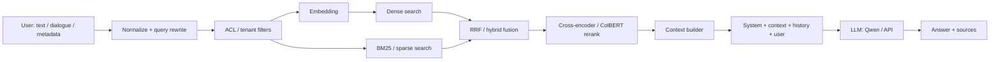
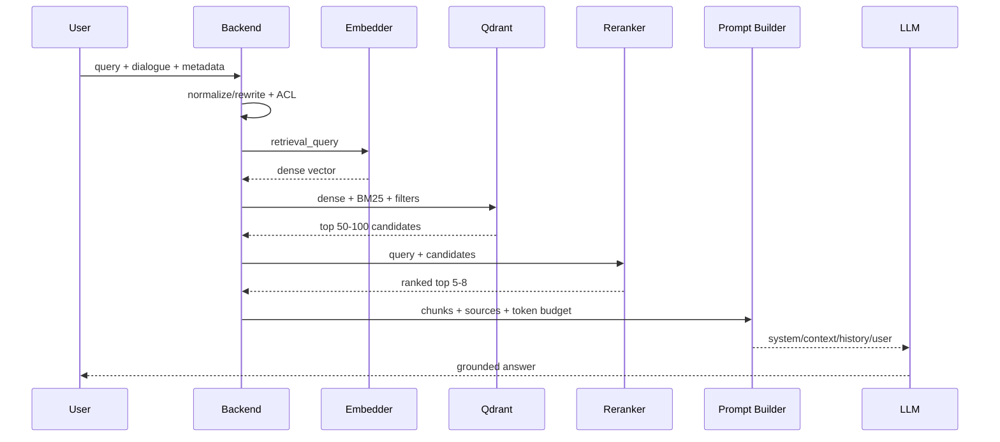
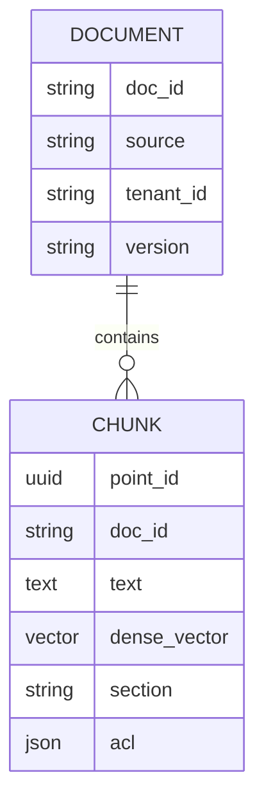
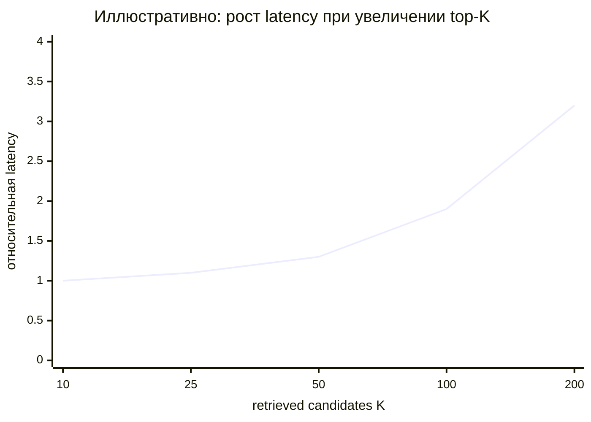

# Подробный RAG runtime-пайплайн: от запроса пользователя до ответа LLM

## Executive summary

RAG — это не функция внутри LLM, а **оркестрационный слой перед генерацией**. На runtime запрос пользователя обычно проходит цепочку:

**input → query normalization/rewrite → embedding → dense/BM25 retrieval → fusion → reranking → context selection → prompt builder → LLM → grounded answer**

Ключевой принцип: вектор нужен **для поиска**, но в LLM обычно передаются **исходные текстовые chunks**, их метаданные и вопрос пользователя. Классическая работа Meta по RAG описывает это как сочетание параметрической памяти генеративной модели с внешней непараметрической памятью; dense retrieval в этой архитектуре восходит к dual-encoder-подходам вроде DPR. citeturn7search0turn7search3

Для production-RAG я бы начинал с следующего baseline: chunks около **300–800 токенов**, overlap **50–100**, dense embedding + BM25, retrieval порядка **50–100 кандидатов**, cross-encoder rerank до **5–8 chunks**, жёсткие ACL/tenant-фильтры до retrieval, итоговый контекст обычно в пределах нескольких тысяч наиболее релевантных токенов. Это не универсальные константы: Qdrant прямо рекомендует измерять candidate depth и `hnsw_ef` на собственном eval-наборе, а не считать большие значения автоматически лучшими. citeturn6view3turn4search12

## Архитектура и timeline

Runtime и offline indexing лучше мыслить раздельно. **Chunking и embedding документов происходят заранее**; в runtime эмбеддится главным образом пользовательский retrieval-query. Qdrant хранит point как vector + JSON payload и позволяет совмещать dense, sparse/BM25, payload filtering и многоступенчатый поиск. citeturn0search24turn0search18turn0search3



Диалоговый запрос часто сначала преобразуется в standalone retrieval-query: например, «а как это настроить?» → «как настроить refresh token в Keycloak?». Query rewriting — отдельная исследованная RAG-стадия, особенно полезная при неоднозначных или контекстно-зависимых запросах. citeturn9search0



## Подготовка corpus: chunking, embeddings и хранение

Chunking влияет на retrieval ещё до runtime. Слишком маленький chunk теряет контекст; слишком большой смешивает несколько тем и «размывает» embedding. Современные исследования также изучают semantic, hierarchical и late chunking; late chunking сначала contextualizes весь длинный текст, а только затем формирует chunk embeddings. citeturn2search38turn2search6

Практический стартовый профиль:

| Параметр | Baseline | Когда менять |
|---|---:|---|
| Chunk size | 300–800 tokens | код/таблицы — по структуре; длинные статьи — 500–1000 |
| Overlap | 50–100 tokens | увеличить при разрыве мыслей между chunks |
| Стратегия | headings → paragraphs → token limit | semantic/late chunking при плохом recall |
| Payload | text, source, doc_id, section, tenant, ACL, version | хранить всё, что нужно для filtering/citations |

Embedding-модель должна оцениваться не только по leaderboard: размер модели влияет на compute/latency, размер вектора — на RAM/disk/search cost, а multilingual/code-домен может быть важнее среднего benchmark. OpenAI позволяет сокращать размер `text-embedding-3` через `dimensions`; Qwen3 Embedding предоставляет модели от 0.6B до 8B с 1024–4096 измерениями и instruction-aware retrieval. citeturn3search0turn1search0turn6view2

| Модель | Размер/вектор | Сильная сторона | Trade-off |
|---|---|---|---|
| OpenAI `text-embedding-3-small` | 1536 default | hosted, простой production API | внешний API |
| OpenAI `text-embedding-3-large` | до 3072 | более высокая retrieval quality | больше vector/storage/стоимость |
| Qwen3-Embedding-0.6B | 0.6B / 1024 | хороший local baseline, multilingual/code | нужен локальный inference |
| Qwen3-Embedding-4B | 4B / 2560 | выше capacity | заметно тяжелее runtime |
| DPR / Meta | dual encoder | фундаментальный dense-retrieval baseline | исследовательский, не современный универсальный default |

OpenAI документирует batching embeddings через массив входов; `llama-server` также имеет OpenAI-compatible `/v1/embeddings`. citeturn3search1turn6view0

```python
# offline
for chunk in chunk(document, target_tokens=500, overlap=75):
    vector = embed(chunk.text)
    qdrant.upsert({
        "id": chunk.id,
        "vector": vector,
        "payload": {
            "text": chunk.text,
            "doc_id": document.id,
            "source": document.uri,
            "section": chunk.section,
            "tenant_id": document.tenant,
            "version": document.version
        }
    })
```



## Runtime retrieval: embedding, Qdrant, hybrid search и reranking

Qdrant collection задаёт dimensionality и distance metric; для text embeddings обычно используют `Cosine`, либо `Dot`, если embeddings нормализованы соответствующим образом. Для unit-normalized vectors cosine и dot дают одинаковое ранжирование. HNSW ускоряет ANN-поиск; повышение `hnsw_ef` обычно улучшает ANN recall ценой latency. citeturn0search9turn4search9turn4search4

Рекомендуемый runtime-контракт:

```json
{
  "query": "Как обновляется access token?",
  "history": [
    {"role": "user", "content": "Мы используем Keycloak"}
  ],
  "filters": {
    "tenant_id": "acme",
    "product": "backend",
    "version": "2026.10"
  }
}
```

| Шаг | Input → output | Стартовые параметры | Ошибка → mitigation |
|---|---|---|---|
| Normalize/rewrite | dialogue → standalone query | последние релевантные turns | потеря контекста → сохранять entities |
| Embedding | query → `float[d]` | та же модель/инструкция, что при indexing | model mismatch → version embedding schema |
| Dense retrieval | vector → candidates | K=50–100, cosine, `hnsw_ef≈100–256` | низкий recall → exact-search benchmark, увеличить ef |
| BM25 | text → lexical candidates | K=50–100 | semantic miss → combine с dense |
| Fusion | два rankings → один | RRF как простой default | несопоставимые scores → rank fusion |
| Rerank | query × candidates → relevance | 30–100 → 5–8 | высокая latency → меньше K/batch/smaller reranker |
| Context | ranked chunks → prompt context | token budget + dedup | duplicates → merge adjacent chunks/MMR |

Qdrant поддерживает native hybrid retrieval: dense и BM25/sparse результаты могут объединяться через Reciprocal Rank Fusion или DBSF; BM25 особенно полезен для артикулов, API names, ошибок и других случаев, где exact lexical match важен наряду с семантикой. citeturn0search3turn0search18

```ts
// TypeScript-like pseudocode
const q = rewrite(messages);
const vector = await embed(q);

const hits = await qdrant.query("knowledge", {
  prefetch: [
    { using: "dense", query: vector, limit: 60, filter: aclFilter },
    { using: "bm25",  query: q,      limit: 60, filter: aclFilter }
  ],
  query: { fusion: "rrf" },
  limit: 50,
  with_payload: ["text", "source", "doc_id", "section"]
});

const ranked = await reranker.rank(q, hits);
const selected = ranked.slice(0, 6);
```

Payload-index нужно создавать на реально используемых filter fields; Qdrant предупреждает, что indexes потребляют дополнительную память. Для multitenancy `tenant_id` должен быть частью server-side filter — Qdrant поддерживает tenant partitioning через payload. citeturn4search0turn5search0

| Qdrant профиль | Настройка | Когда |
|---|---|---|
| Accuracy | HNSW, высокий `hnsw_ef`, float vectors | небольшой/средний corpus |
| Balanced | HNSW + indexed payload + cached vectors | типичный production RAG |
| Memory-first | cold vectors/index + quantization | большой corpus, RAM ограничена |

Qdrant позволяет размещать vectors/HNSW в разных memory tiers и использовать `float16`, `uint8` и quantized representations. citeturn4search2turn4search3

### Reranking

Bi-encoder вычисляет embeddings query/document независимо и поэтому масштабируется на огромный corpus; cross-encoder видит пару `query + document` совместно и подходит для дорогой второй стадии после candidate retrieval. SBERT показал мотивацию bi-encoder retrieval именно через возможность заранее вычислять document embeddings; ColBERT занимает промежуточную позицию с late interaction. citeturn2search0turn2search1

| Подход | Скорость | Interaction | Применение |
|---|---|---|---|
| Bi-encoder | высокая | vector similarity | first-stage retrieval |
| Cross-encoder | ниже | полный query↔chunk | top-20…100 reranking |
| ColBERT | средняя | token-level late interaction | quality/latency компромисс |

Qwen предлагает отдельные Qwen3-Reranker 0.6B/4B/8B; `llama.cpp` также предоставляет `/rerank` endpoint для совместимых reranker-моделей. citeturn6view2turn6view1

## Context builder и интеграция с LLM

После reranking начинается часть RAG, которую часто недооценивают: **какие именно chunks реально попадут в prompt**.

Token budget удобно считать явно:

```text
retrieval_budget =
    context_window
  - system_tokens
  - dialogue_tokens
  - user_tokens
  - reserved_output_tokens
  - safety_margin
```

Затем chunks добавляются по relevance, но с deduplication, ограничением количества фрагментов с одного документа и сохранением source metadata. Просто заполнить всё доступное context window обычно не оптимально: исследования long-context моделей обнаружили «lost in the middle» — информация в середине большого контекста может использоваться хуже, чем в начале или конце. citeturn8search1

Пример итогового input:

```json
{
  "messages": [
    {
      "role": "system",
      "content": "Отвечай только на основании CONTEXT. Указывай source_id."
    },
    {
      "role": "user",
      "content": "CONTEXT:\n<doc id='auth#42'>...</doc>\n<doc id='session#7'>...</doc>\n\nQUESTION:\nКак обновить access token?"
    }
  ]
}
```

При переполнении context window порядок mitigation обычно такой: удалить low-score chunks → убрать duplicates → ограничить chunks на source → сократить историю диалога → сделать query-aware condensation длинных chunks. Обрезание текста «первые N токенов каждого документа» хуже осмысленного selection, потому что релевантный passage может находиться дальше.

Локальный вариант:

```ts
const llm = new OpenAI({
  baseURL: "http://localhost:8080/v1",
  apiKey: "local"
});

await llm.chat.completions.create({
  model: "qwen",
  messages,
  temperature: 0.1
});
```

`llama-server` поддерживает OpenAI-compatible chat/embedding endpoints, continuous batching, parallel decoding и monitoring endpoints; prompt/KV reuse также поддерживается для подходящих режимов. citeturn6view0turn6view1

Для API-варианта меняется в основном provider adapter; retrieval pipeline можно оставить тем же. Полезно отдельно кэшировать `embedding(query, model_version)`, retrieval results по `query + filters + index_version` и неизменяемые document embeddings. Batching особенно полезен при ingestion и cross-encoder reranking.

Иллюстративная, **не benchmark**, зависимость candidate depth от latency:



Причина тренда прежде всего в том, что downstream reranker должен обработать каждый кандидат; Qdrant рекомендует отдельно измерять `limit` и `hnsw_ef`, включая сравнение ANN с exact retrieval. citeturn6view3turn4search12

## Безопасность, наблюдаемость и критерии качества

Retrieved text нельзя считать доверенными инструкциями. OWASP отдельно выделяет indirect prompt injection через RAG-документы и рекомендует отделять retrieved content delimiters от инструкций, ограничивать размер retrieval-context и проверять поступающий контент. citeturn6view4turn5search1

Для enterprise-RAG минимальный security boundary выглядит как **authentication → server-side ACL/tenant filter → retrieval → PII policy → trusted-source allowlist → prompt**. Нельзя полагаться на то, что embedding «анонимизирует» исходные данные; NIST отдельно рассматривает sensitive information/PII в RAG databases как поверхность утечки. citeturn5search5

Мониторинг нужно разделять по слоям:

| Слой | Основные метрики |
|---|---|
| System | p50/p95/p99 latency каждого stage, QPS, errors, cache hit |
| Retrieval | Recall@K, Precision@K, HitRate, nDCG |
| Reranking | Recall после rerank, MRR/nDCG, latency/query |
| Generation | answer accuracy, faithfulness/groundedness, citation correctness |
| RAG overall | end-to-end latency, token usage, unsupported-claim/hallucination rate |

RAGAS формализует раздельную оценку retrieval relevance и faithfulness генерации; ANN recall также следует измерять против exact nearest-neighbour ground truth, а не только по субъективному качеству нескольких ответов. citeturn8search0turn7search1turn4search12

Практически полезно иметь gold dataset вида:

```json
{
  "question": "Как обновить access token?",
  "relevant_chunks": ["auth#42", "session#7"],
  "expected_facts": [
    "используется refresh token",
    "при ошибке требуется re-auth"
  ]
}
```

Тогда можно отличить **retrieval failure** («нужный chunk не нашли») от **generation failure** («chunk нашли, но LLM ответила неправильно»).

## Рекомендуемая production-конфигурация

Для локального русско-/англоязычного RAG на Qdrant + Qwen разумный стартовый стек — `Qwen3-Embedding-0.6B` → Qdrant dense+BM25 → RRF → Qwen3-Reranker-0.6B → 5–8 лучших chunks → Qwen через `llama.cpp`. Более крупные embedding/reranking модели стоит включать только после измерения прироста Recall@K/nDCG относительно latency и памяти; семейство Qwen3 специально предоставляет 0.6B/4B/8B варианты для такого trade-off. citeturn6view2

RAG следует предпочитать, когда знания **часто меняются, приватны, должны фильтроваться по ACL или требуют provenance/citations**. Fine-tuning лучше рассматривать как способ изменить поведение, формат, стиль или специализированные навыки модели, а не как замену оперативно обновляемой knowledge base. Экспериментальные работы по сравнению knowledge injection показывают, что RAG и fine-tuning решают разные задачи и могут дополнять друг друга; результат зависит от конкретного benchmark и качества retriever. citeturn8search2turn8search5

Итоговая production-архитектура поэтому выглядит не как:

`Question → LLM`

а как:

**`Question + dialogue + identity → rewrite → embedding → ACL-filtered hybrid retrieval → rerank → token-aware context selection → guarded prompt → LLM → answer + citations → evaluation/telemetry`**.

Именно retrieval/ranking/context stages определяют, **какие факты LLM вообще получит возможность увидеть**; увеличение контекстного окна само по себе эту проблему не устраняет. citeturn7search0turn8search1
